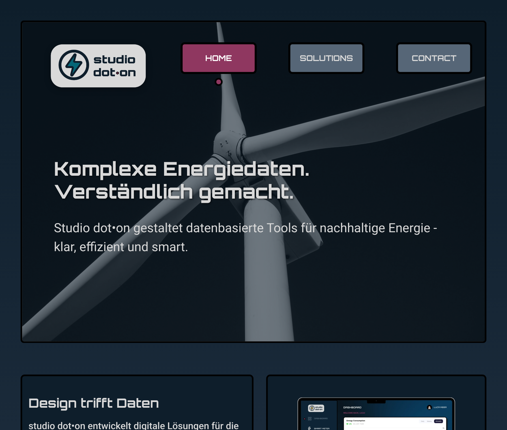
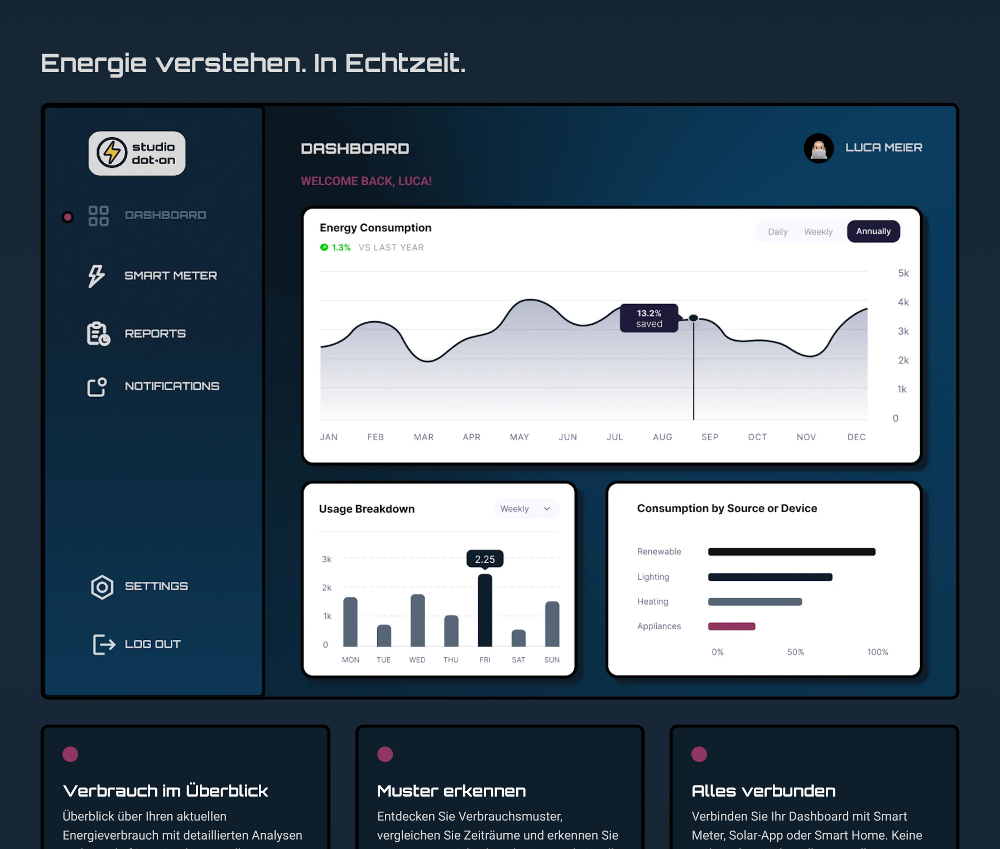
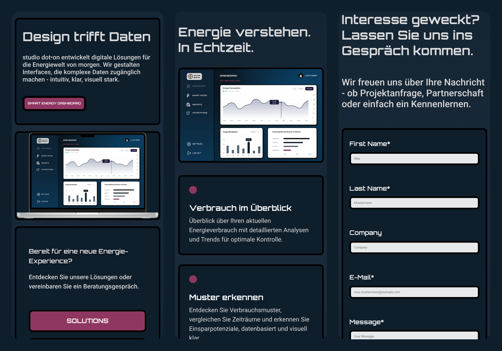

# Studio dot•on: Energy Data Design Studio

A responsive, multi-page website for **Studio dot•on**, a fictional Zurich-based design studio that turns complex energy data into clear, usable interfaces. Built from scratch with semantic HTML and pure CSS. No JavaScript, no frameworks, no build tools.




## Overview

Studio dot•on is a 5-page static website presenting a studio that designs data-driven tools for sustainable energy. The homepage introduces the studio and its flagship product, the Smart Energy Dashboard. The Solutions page showcases the dashboard and its core features, and the Contact page offers a structured enquiry form. Impressum and Data Privacy pages complete the site, as a real Swiss business would need them.

The focus of the project was building a complete website from concept to code: defining the brand, designing wireframes and screens in Figma, and translating that design system into clean, maintainable HTML and CSS. Every layout, interaction and responsive behaviour is handled in CSS alone.

## Features

- **Responsive layout** across all 5 pages, with breakpoints from small phones (320px) up to large desktop screens
- **CSS-only mobile navigation**: the burger menu works without any JavaScript, using a checkbox toggle and sibling selectors
- **Design tokens** for colours, spacing, font sizes, radii and borders, defined once as CSS custom properties and reused throughout
- **Custom brand identity**: logo, colour palette and the signature "dot" motif, which marks the active navigation item and recurs in the feature cards
- **Dashboard showcase** on the Solutions page, presenting the Smart Energy Dashboard UI alongside its three core features
- **Accessible markup**: semantic landmarks, descriptive alt texts, labelled form fields and ARIA labels on icon-only links
- **Optimised assets**: WebP images and self-hosted variable fonts, keeping the whole site under 1 MB



## Pages

| Page | Purpose |
|---|---|
| `index.html` | Home: hero, studio introduction, dashboard preview |
| `solutions.html` | Smart Energy Dashboard showcase and feature overview |
| `contact.html` | Contact form for project enquiries |
| `impressum.html` | Legal notice |
| `data-privacy.html` | Privacy policy |

## Tech Stack

- **HTML5**: semantic markup
- **CSS3**: Flexbox, Grid, custom properties, media queries, no framework
- **Fonts**: self-hosted variable fonts (Orbitron, Roboto)
- **Images**: WebP

The project intentionally uses no JavaScript. Everything, including the mobile menu and hover states, is solved in CSS, to build a solid command of layout and styling before adding scripting on top.

## Getting Started

This is a static site with no build step or dependencies to install.

```bash
git clone https://github.com/TechFusion94/Studio-dot-on.git
cd Studio-dot-on
```

Then simply open `index.html` in your browser, or serve it locally (e.g. with the VS Code "Live Server" extension) so relative paths and fonts load correctly.

## Project Structure

```
Studio-dot-on/
├── index.html, solutions.html, contact.html, impressum.html, data-privacy.html
├── assets/
│   └── css/
│       ├── variables.css     # design tokens: colours, spacing, typography
│       ├── shared.css        # header, navigation, footer, shared components
│       └── main.css, solutions.css, contact.css, ...   # per-page styles
├── fonts/                    # Orbitron, Roboto (variable fonts, OFL licensed)
├── images/                   # logo, icons, photography, dashboard visuals
│   └── screenshots/          # README screenshots
└── README.md
```

## Design & Credits

Brand identity, wireframes and screen designs created in Figma as part of this project, including the Smart Energy Dashboard UI. Fonts: [Orbitron](https://fonts.google.com/specimen/Orbitron) and [Roboto](https://fonts.google.com/specimen/Roboto) (Google Fonts, OFL licensed).

---

Built by **Luca Meier** as part of the Web Development Basics module at SAE Institute.
